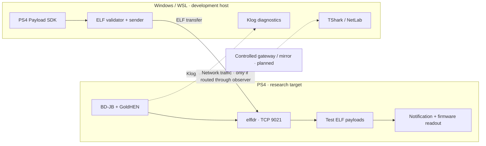

<div align="center">

# middleManPS4

**PS4 Payload Research · Firmware Diagnostics · Network Observation**

[](https://github.com/oakvx/middleManPS4)
[](VERSION)
[](https://github.com/oakvx/middleManPS4)
[](pyproject.toml)

*An experimental toolkit for understanding how a PS4 loads homebrew payloads and communicates with network services.*

[Overview](#overview) · [Project status](#project-status) · [Architecture](#architecture) · [Quick start](#quick-start) · [Roadmap](#roadmap)

</div>

> [!IMPORTANT]
> **ACTIVE DEVELOPMENT — WIP / RESEARCH PROTOTYPE**
>
> **middleManPS4 does not currently bypass PlayStation Network authentication, spoof the system firmware, or enable PSN sign-in on unsupported firmware.** Those are research questions, **not available features**. This is not a plug-and-play PSN unlocker.

## Overview

**middleManPS4** is an independent PS4 research workspace built around three complementary areas:

- **Payload development:** compile, validate and transfer ELF test payloads using the PS4 Payload SDK and a compatible loader.
- **System diagnostics:** read the software version and observe test-payload output without modifying the installed firmware.
- **Network research:** collect limited DNS/TLS/TCP metadata and compare baseline traffic against a PSN sign-in attempt, without decrypting or rewriting HTTPS sessions.

The original internal tooling is named **`fwSpoofer`**. The repository name **`middleManPS4`** reflects the long-term interest in network-path analysis; it does **not** imply that a working transparent MITM or authentication bypass is available.

## Project status

| Component | Status | Evidence / limitation |
|:--|:--:|:--|
| PS4 Payload SDK build | ✅ Verified | `hello_world.elf` and `firmware_info.elf` compiled under WSL |
| BD-JB → GoldHEN → `elfldr` | ✅ Tested | TCP loader reachable on `9021` in one real-console setup |
| ELF execution | ✅ Tested | Hello World notification observed on console |
| Firmware readout | ✅ Tested | `sceKernelGetSystemSwVersion` returned `12.520.001` (`0x12520001`) |
| Offline ELF checks and host tests | ✅ Available | Automated tests; not a guarantee of compatibility |
| Klog diagnostic tooling | ✅ Available | No PSN-specific log event identified in the test run |
| Passive network analysis | 🧪 In testing | Local capture verified; PS4-to-Internet visibility not established |
| Gateway-based PSN traffic observation | ⏳ Planned | Requires a controlled network path |
| Firmware-version spoofing | ❌ Not implemented | No firmware or kernel version patch |
| PSN login bypass | ❌ Not implemented | No proof that a bypass is feasible |

**Hardware experiment:** one PS4 on system software **12.52**, using **BD-JB** and **GoldHEN 2.4b18.7**. These results are **configuration-specific**; other firmware versions, jailbreak methods and loader builds may behave differently.

## Architecture



The network lab operates **independently** from the payload loader. Merely connecting a PC and PS4 to the same Wi-Fi network usually does **not** expose the console's Internet-bound unicast traffic to the PC.

## Repository layout

```text
middleManPS4/
├── payloads/     # PS4 test payloads and shared code
├── host/         # Python sender, ELF validation and NetLab
├── scripts/      # Build, bootstrap and offline verification helpers
├── tests/        # Unit and regression tests
├── docs/         # Architecture, experiments and technical notes
├── configs/      # Configuration examples
├── Makefile
└── README.md
```

## Quick start

### Requirements

- **Python 3.11+** for host utilities and offline tests.
- **Linux / WSL Ubuntu + [ps4-payload-dev/sdk](https://github.com/ps4-payload-dev/sdk)** for compiling PS4 payloads.
- **TShark + Npcap** on Windows for network-capture experiments (optional).
- An **owned or explicitly authorized** PS4 and network for hardware tests.

### Clone and verify offline

```bash
git clone https://github.com/oakvx/middleManPS4.git
cd middleManPS4

python -m unittest discover -s tests -v
```

For a full local preflight (including the repository's checksum manifest):

```bash
python scripts/preflight_offline.py
```

> [!NOTE]
> The preflight is **offline**. It cannot confirm that an ELF executed on a PS4, and its checksum check will fail after you modify any file listed in `SHA256SUMS.txt` until you regenerate the corresponding manifest entry.

### Build test payloads

Configure the installed SDK and build from Linux or WSL:

```bash
export PS4_PAYLOAD_SDK="$HOME/ps4-payload-sdk-1252"  # adjust to your installation
make
```

**Do not send experimental payloads to a console without reviewing the loader, firmware support and documentation first.** A successful TCP transfer does not prove remote execution.

### Explore the network lab

```bash
# List capture interfaces
python -m host.ps4_sender.psn_netdiag interfaces

# Compare two existing metadata summaries (no network activity)
python -m host.ps4_sender.psn_triage \
  --baseline baseline.json \
  --attempt psn_attempt.json
```

Read [PSN NetLab technical notes](docs/PSN-NETLAB-v10.md) before attempting a capture. **Do not upload packet captures, credentials, authentication tokens or identifiable network logs to public issues.**

## Roadmap

- [x] PS4 SDK toolchain and ELF payload build.
- [x] GoldHEN / `elfldr` experimental loading path.
- [x] Real-console Hello World and read-only firmware information tests.
- [x] Offline validation, diagnostics and regression-test scaffolding.
- [x] Initial passive packet-capture tooling.
- [ ] Verify visibility of PS4 Internet traffic through a controlled gateway or mirrored port.
- [ ] Characterize the system-update prompt and relevant *observable* network events.
- [ ] Separate client-side checks from server-side requirements using reproducible evidence.
- [ ] Assess whether any proposed spoofing technique is feasible, without assuming success.
- [ ] Improve documentation, repeatability and compatibility reporting.

## Research boundaries

- **No PSN bypass is claimed.** A displayed firmware version is not proof of server acceptance.
- **No TLS decryption or credential interception is provided.** The optional CONNECT tunnel forwards encrypted data without changing the contents.
- **No permanent system update or firmware patch is performed by the current diagnostic payload.**
- **No universal compatibility is claimed.** Payloads can crash a console or require a reboot.
- **PSN access may require Sony-side checks that a local spoof cannot satisfy.** Modified systems may also face account or console restrictions.

Use this repository **only on hardware and networks you own or are authorized to inspect**. Keep experiments reversible, avoid important accounts and never disclose session material.

## Documentation

- [Project architecture](docs/architecture.md)
- [Payload development](docs/payload-development.md)
- [Firmware information](docs/firmware-info.md)
- [PSN NetLab](docs/PSN-NETLAB-v10.md)
- [Changelog](CHANGELOG.md)

> [!WARNING]
> Documentation is evolving with the experiments. Older notes may describe paths that were not yet validated when written; verify claims against the current code and test evidence.

## License and contributions

**No license has been published yet.** The source is viewable on GitHub, but this does not automatically grant permission to redistribute or reuse it. Contributions, issues and technical discussions should focus on reproducible observations, non-sensitive logs and clearly separated facts versus hypotheses.

---

<div align="center">

**middleManPS4** · *Built to investigate, not to overpromise.*

**WORK IN PROGRESS — NOT A RELEASED PSN BYPASS**

[Repository](https://github.com/oakvx/middleManPS4) · [Issues](https://github.com/oakvx/middleManPS4/issues)

</div>
