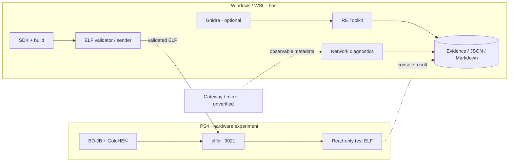

<div align="center">

# middleManPS4

### PS4 RESEARCH LAB // PAYLOADS · REVERSE ENGINEERING · NETWORK OBSERVABILITY

[](https://github.com/oakvx/middleManPS4)
[](VERSION)
[](pyproject.toml)
[](https://github.com/oakvx/middleManPS4/actions/workflows/ci.yml)

**An evidence-driven research toolkit for PS4 homebrew payloads, Orbis binaries and observable network behavior.**

[Quick start](#-quick-start) · [Toolkit](#-toolkit) · [Architecture](#-architecture) · [Compatibility](#-compatibility--evidence) · [Roadmap](#-roadmap) · [Documentation](#-documentation)

</div>

```text
  PS4 / GoldHEN                  Windows / WSL
  ─────────────                  ─────────────
  payload execution ──────────►  ELF validation + diagnostics
  firmware information ───────►  structured evidence
  observable network metadata ►  offline correlation
                                 │
  ELF / SFO / Orbis artifacts ───┴──► RE Toolkit ──► JSON / Markdown
                                         ▲
                                     Ghidra (optional)
```

> [!IMPORTANT]
> **RESEARCH PROTOTYPE — NOT A PSN UNLOCKER.**
> This project **does not** currently spoof PS4 firmware, bypass PSN authentication, decrypt PSN TLS sessions or enable online play on unsupported firmware. Documentation distinguishes *implemented features*, *local tests* and *unverified hypotheses*.

## What is middleManPS4?

**middleManPS4** (originally developed under the working name `fwSpoofer`) is a modular PS4 research workspace. It brings together four areas that are easier to investigate when they share one evidence format:

| Area | Purpose | What you get |
|:--|:--|:--|
| **Payload Lab** | Build and validate test ELF payloads; interact with a compatible loader | ELF validation, sender, loader diagnostics |
| **Firmware Diagnostics** | Query local system information from a test payload | Read-only firmware version observations |
| **Network Lab** | Determine which PS4 traffic is actually visible to an observer | Capture metadata, baseline comparisons, visibility counters |
| **RE Toolkit** | Inspect PS4-related artifacts offline and integrate Ghidra output | Orbis/ELF, PSF, NIDs, dependencies, JSON/Markdown reports |

The word **middleMan** describes an experimental interest in *network-path observation*. **Being on the same Wi-Fi is not equivalent to being in the traffic path**, and the project makes no claim of having a working transparent MITM.

## ⚡ Quick start

**Host tools only — no PS4 connection required.** The commands below are designed for Python **3.11+** and run from the repository root.

```powershell
# Clone the source (the public main branch may lag behind this local snapshot)
git clone https://github.com/oakvx/middleManPS4.git
cd middleManPS4

# Run the offline test suite
python -m unittest discover -s tests -v

# Analyze a local ELF (when dist/firmware_info.elf is available)
python -m host.ps4_sender.rekit analyze .\dist\firmware_info.elf

# Produce a reviewable case report
New-Item -ItemType Directory -Force .\reports | Out-Null
python -m host.ps4_sender.rekit analyze .\dist\firmware_info.elf --output .\reports\case.json
python -m host.ps4_sender.rekit markdown .\reports\case.json --output .\reports\case.md
```

> [!NOTE]
> **v0.14.0 is an experimental local snapshot.** At the time this README was written, GitHub `main` was still at v0.10.0. The v0.14 commands require the **v0.14 project archive/patch**, not just a fresh clone of `main`. The `--output` commands deliberately refuse to overwrite an existing report: use new filenames for subsequent runs.

## 🧰 Toolkit

<details open>
<summary><b>01 / Offline reverse engineering</b> — ELF, Orbis, NIDs, Ghidra and reports</summary>

The RE Toolkit processes **existing files** on the host; it does not patch firmware or execute code on the console.

```powershell
# Binary identity and ELF/Orbis structures
python -m host.ps4_sender.rekit binary .\dist\firmware_info.elf
python -m host.ps4_sender.rekit orbis .\dist\firmware_info.elf
python -m host.ps4_sender.rekit dynlib .\dist\firmware_info.elf

# Symbols and potential NID references
python -m host.ps4_sender.rekit symbols .\dist\firmware_info.elf
python -m host.ps4_sender.rekit nids .\dist\firmware_info.elf

# Inventory a group of ELF files and compare existing reports
python -m host.ps4_sender.rekit batch .\dist --glob "*.elf"
python -m host.ps4_sender.rekit analyze-diff .\reports\before.json .\reports\after.json
```

The analyzer differentiates **validated dynamic string-table candidates** from general string matches. Static references are *not proof that a code path executes*, nor that PSN will accept a version claim.

**Ghidra integration:** optional headless inventory export; provide a local Ghidra installation, input ELF and output path. See [RE Toolkit v0.14](docs/RE-TOOLKIT-v14.md). The export script has undergone offline validation, **not a full run against an installed Ghidra instance**.

</details>

<details>
<summary><b>02 / Payload development</b> — build, inspect, transfer</summary>

A Linux/WSL environment with the [PS4 Payload SDK](https://github.com/ps4-payload-dev/sdk) is used for compilation. Example:

```bash
export PS4_PAYLOAD_SDK="$HOME/ps4-payload-sdk-1252"  # set your actual SDK directory
make
```

The sender is designed around the tested `elfldr` TCP **9021** path. Upload success does **not** prove successful execution; check console-side output and loader responses. Read [Payload development](docs/payload-development.md) and [Loader installation](docs/loader-install.md) before any hardware test.

</details>

<details>
<summary><b>03 / Network diagnostics</b> — passive capture and visibility checks</summary>

```powershell
# Discover local capture interfaces
python -m host.ps4_sender.psn_netdiag interfaces

# Compare two already-collected metadata summaries
python -m host.ps4_sender.psn_triage --baseline baseline.json --attempt psn_attempt.json

# Inspect an existing summary offline
python -m host.ps4_sender.rekit net .\baseline.json
```

Network data is useful **only if the observer is actually on the packet path**. A local ICMP reply does not demonstrate visibility of PS4-to-Internet traffic. See [PSN path visibility](docs/PSN-VISIBILITY-v11.md) and [Network Lab](docs/PSN-NETLAB-v10.md).

The toolkit does **not** intercept credentials, decrypt TLS or impersonate Sony endpoints.

</details>

## 🧬 Architecture



For the current design, see [architecture.md](docs/architecture.md). The diagram shows **data flow and intended integration**, not successful PSN authentication or interception.

## 🧪 Compatibility & evidence

| Component | State | Evidence and limits |
|:--|:--:|:--|
| ELF compilation and host validation | **Tested** | Local toolchain and automated tests |
| GoldHEN → `elfldr` on TCP 9021 | **Hardware-tested** | One PS4 test setup |
| Hello World payload | **Hardware-tested** | Notification observed on console |
| Firmware readout | **Hardware-tested** | `sceKernelGetSystemSwVersion` → `12.520.001` |
| Offline RE Toolkit | **Tested locally** | ELF, Orbis, PSF, NID and report analysis |
| Ghidra headless runtime | **Not yet hardware/software-tested** | Script checked offline; live integration pending |
| Public-Internet traffic visibility | **Not yet demonstrated** | Requires controlled gateway / mirror capture |
| Firmware spoofing | **Not implemented** | No system-version patch |
| PSN sign-in bypass | **Not implemented** | No supported end-to-end demonstration |

**Reference hardware:** PS4 system software **12.52** with BD-JB and **GoldHEN 2.4b18.7**. These observations do **not** establish compatibility for other consoles or firmware revisions.

**v0.14 offline validation:** 195 automated tests passed in the development snapshot. This is an *offline test result*, not a certification of runtime safety or remote compatibility.

## 🗺️ Roadmap

- [x] Build and validate PS4 test payloads.
- [x] Exercise one GoldHEN + `elfldr` loading path on actual hardware.
- [x] Capture read-only firmware information.
- [x] Establish host-side regression tests and integrity checks.
- [x] Implement passive network metadata analysis with path-visibility counters.
- [x] Add offline ELF/Orbis, PSF, NID and dynamic-dependency inspection.
- [x] Generate comparable case reports and optional Ghidra inventory correlations.
- [ ] Validate Ghidra headless export on a real Ghidra installation.
- [ ] Demonstrate PS4-to-Internet packet visibility via a controlled gateway or mirror.
- [ ] Correlate reproducible client-side events with network observations.
- [ ] Investigate firmware-version checks without presuming an effective bypass.
- [ ] Improve public release packaging and documentation.

## 📁 Repository map

```text
middleManPS4/
├── payloads/         # PS4 test payloads and shared C code
├── host/             # Python sender, NetLab, diagnostics and rekit
├── scripts/          # Build, checks, optional Ghidra scripts
├── tests/            # Offline regression tests
├── docs/             # Runbooks, analysis and design notes
├── configs/          # Configuration examples
├── dist/             # Locally built/staged test binaries
├── pyproject.toml
├── SHA256SUMS.txt     # Snapshot integrity manifest
└── README.md
```

The offline preflight validates checksums and runs the test suite:

```powershell
python scripts/preflight_offline.py
```

If you edit a tracked file, the snapshot checksum check will correctly detect the change until you update its entry in `SHA256SUMS.txt`.

## 📚 Documentation

| Guide | Topic |
|:--|:--|
| [RE Toolkit v0.14](docs/RE-TOOLKIT-v14.md) | Integrated analysis, report commands, Ghidra inventory |
| [RE Toolkit v0.13](docs/RE-TOOLKIT-v13.md) | Dynamic ELF data, NIDs and Ghidra bridge |
| [Network visibility v0.11](docs/PSN-VISIBILITY-v11.md) | Observing the right traffic path |
| [PSN NetLab v0.10](docs/PSN-NETLAB-v10.md) | Network metadata diagnostics |
| [Payload development](docs/payload-development.md) | Building and executing test payloads |
| [Architecture](docs/architecture.md) | Components and assumptions |
| [Changelog](CHANGELOG.md) | Changes and experiment history |

## Responsible research

> [!CAUTION]
> Only test on hardware and networks you own or are authorized to inspect. Avoid real accounts during experiments. **Never publish credentials, tokens, packet captures containing personal data or identifiable network logs.** The project makes no guarantee of compatibility, safety or access to PSN.

**License:** no license has been published yet. Public visibility of the source does not automatically grant rights to reuse or redistribute it. Reports of reproducible observations are welcome through [GitHub Issues](https://github.com/oakvx/middleManPS4/issues).

---

<div align="center">

**middleManPS4** · *Measure first. Reverse engineer second. Make claims only when the evidence holds.*

`RESEARCH / WIP` · `NO PSN BYPASS` · `v0.14.0 LOCAL SNAPSHOT`

[GitHub](https://github.com/oakvx/middleManPS4) · [Issues](https://github.com/oakvx/middleManPS4/issues) · [Changelog](CHANGELOG.md)

</div>
