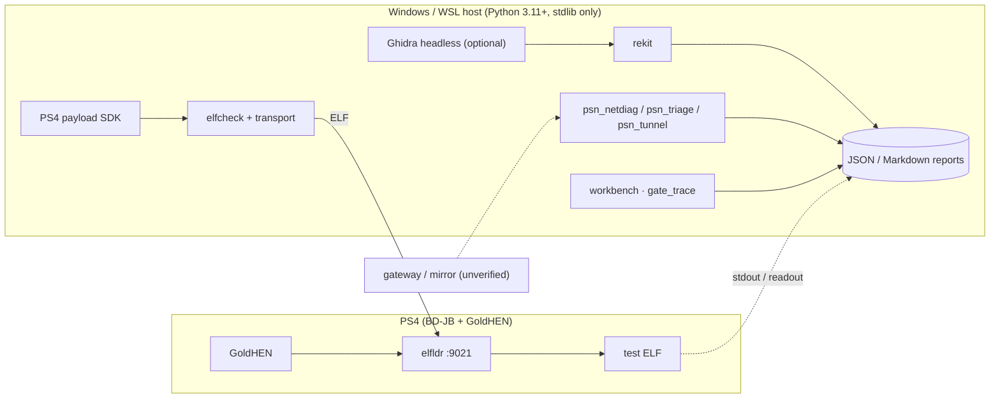

<div align="center">

# middleManPS4

**PS4 payload lab · offline Orbis/ELF analysis · metadata-only network observability**

<p>


</p>

Formerly `fwSpoofer`.

</div>

> **Scope.** Research tooling for a console and a network you own. This is **not** a PSN unlocker: no firmware-version spoofing, no PSN authentication bypass, no TLS interception or decryption, no credential capture. Every capability below is labelled *tested*, *untested* or *not implemented*.

## Contents

- [Research question](#research-question)
- [System overview](#system-overview)
- [Components](#components)
- [Design constraints](#design-constraints)
- [Quick start](#quick-start)
- [CLI reference](#cli-reference)
- [Hardware evidence](#hardware-evidence)
- [Roadmap](#roadmap)
- [Documentation](#documentation)
- [Safety and license](#safety-and-license)

## Research question

Does PSN check the reported system version client-side, server-side or both, and is that check even reachable from the network path? Unknown. Three preconditions must hold before "spoofing" is more than a hypothesis, and none is established:

- [ ] PS4 → Internet traffic is visible to an observer (same Wi-Fi does not imply on-path).
- [ ] The version claim travels somewhere outside TLS (likely blocker).
- [ ] The server side cares, independently of the client.

The repository gathers evidence on these three points; it does not try to bypass them.

## System overview



## Components

| Path | Language | Role | Touches console |
| --- | --- | --- | --- |
| `payloads/` (`hello_world`, `firmware_info`, `observer`, `common`) | C, PS4 payload SDK | Test payloads, built with `make` and `PS4_PAYLOAD_SDK` | Yes, via `elfldr` |
| `host/ps4_sender/` `elfcheck`, `transport`, `cli` | Python | Validate an ELF and send it to `elfldr` on TCP 9021 | Yes |
| `host/ps4_sender/diagnostics.py` | Python | Read-only firmware readout (`sceKernelGetSystemSwVersion`) | Yes |
| `host/ps4_sender/psn_netdiag`, `psn_triage`, `psn_diag` | Python | Passive DNS/TCP/TLS **metadata**; baseline vs. sign-in attempt | No |
| `host/ps4_sender/psn_tunnel.py` | Python | Opaque HTTPS `CONNECT` forwarder that logs metadata only (see below) | Network only |
| `host/ps4_sender/rekit/` | Python | Offline ELF / Orbis / PSF / NID / symbol inspection, reports, Ghidra bridge | No |
| `host/ps4_sender/gate_trace.py` | Python | Offline correlator of `observer.elf` stdout and network metadata around a manual marker | No |
| `host/ps4_sender/workbench.py`, `workbench_ui.py` | Python | Unified case builder, integrity verification, replay, localhost dashboard | No |

The host package has **no runtime dependencies** (`dependencies = []`).

### Observer ELF (experimental)

`observer.elf` is a read-only self-observation prototype: it reads firmware information, prints its own PID and emits 12 timed heartbeats. Host-C mock tests pass; PS4 cross-build and runtime are **not verified**. It does not hook PSN processes, decrypt TLS, collect credentials, spoof firmware or bypass authentication. See [Observer v0.15](docs/OBSERVER-v15.md).

### Gate trace v0.16 (offline)

Reads allowlisted `observer.elf` stdout and an existing `psn_netdiag` JSON, then counts DNS/TCP/TLS metadata on either side of a manually entered "update dialog appeared" marker. The clock marker is manual: this is **not** synchronized process tracing and not proof of a local or server firmware gate. Bundled inputs are synthetic. See [Gate Trace v0.16](docs/GATE-TRACE-v16.md).

```powershell
python -m host.ps4_sender.gate_trace --observer examples/observer_v016_sample.txt --network examples/netmeta_v016_sample.json --prompt-second 5 --window-seconds 3
```

### Research workbench v0.17 (offline)

Combines the Observer stdout parser, metadata-based network intelligence, offline ELF/PSF static diff, a **localhost-only read-only dashboard**, rule-based analysis (local Ollama only if separately opted in), a non-transmitting event replay and SHA-256 integrity reports. Demo inputs are synthetic. System-wide process enumeration and firmware-gate attribution are **not implemented or proven**. See [Research Workbench v0.17](docs/RESEARCH-WORKBENCH-v17.md).

```powershell
New-Item -ItemType Directory -Force .\reports | Out-Null
python -m host.ps4_sender.workbench case --observer examples/observer_v016_sample.txt --network examples/netmeta_v016_sample.json --prompt-second 5 --output reports\synthetic.json
python -m host.ps4_sender.workbench verify --report reports\synthetic.json
python -m host.ps4_sender.workbench dashboard --report reports\synthetic.json
```

### `psn_tunnel`: metadata-only CONNECT forwarder

A strict forwarder for a user's own PS4. It relays opaque encrypted bytes and is explicitly not a TLS MITM.

| Property | Behavior |
| --- | --- |
| Client | Exactly one private IPv4 (`--client-ip`); other sources are dropped |
| Listening | Loopback by default; LAN requires `--allow-lan`. **Dry run** unless `--serve` is given |
| Window | 5–300 s listening time; each tunnel capped at 120 s; at most 8 concurrent |
| Requests | `CONNECT host:443` only, strict header syntax; no plaintext forwarding |
| Destinations | Valid public hostnames or global IPs; `localhost`, `.local`, `.internal` and non-global addresses are refused |
| DNS | Resolved once and connected to a vetted global address (no second lookup, no rebinding) |
| Logging | Host, port, result and byte counts only. No headers, bodies, tokens, certificates or TLS records |
| Report | Optional JSONL, **new file only** |

```powershell
# dry run: validates arguments, opens nothing
python -m host.ps4_sender.psn_tunnel --client-ip 192.168.1.50 --report reports\tunnel.jsonl
# serve on the LAN for the PS4 only
python -m host.ps4_sender.psn_tunnel --client-ip 192.168.1.50 --bind 192.168.1.10 --allow-lan --serve --seconds 90
```

Then set the PS4 HTTPS proxy to the host address and port, and **remove it afterwards**.

## Design constraints

- **Read-only on the console.** Firmware readout and observer only read; nothing patches, hooks or injects into system processes.
- **No overwrite.** Report and Markdown writers create new files exclusively; `--output` never replaces an existing file.
- **Metadata only.** Network tooling records DNS/TCP/TLS metadata. No credential capture, TLS decryption or endpoint impersonation.
- **Claims are tagged.** A static string match is not proof that a code path runs, and not proof that PSN accepts anything.
- **Single-config evidence.** Results apply to one console and firmware only (below).

## Quick start

```powershell
git clone https://github.com/oakvx/middleManPS4.git
cd middleManPS4
python -m unittest discover -s tests -v
```

```powershell
python -m host.ps4_sender.rekit analyze .\dist\firmware_info.elf
python -m host.ps4_sender.rekit analyze .\dist\firmware_info.elf --output .\reports\case.json
python -m host.ps4_sender.rekit markdown .\reports\case.json --output .\reports\case.md
```

Build payloads (targets the tested `elfldr` TCP 9021 path):

```bash
export PS4_PAYLOAD_SDK="$HOME/ps4-payload-sdk-1252"
make
```

A successful upload is not a successful execution: check the console. Read [payload-development.md](docs/payload-development.md) first; bad payloads crash consoles.

Network lab:

```powershell
python -m host.ps4_sender.psn_netdiag interfaces
python -m host.ps4_sender.psn_triage --baseline baseline.json --attempt psn_attempt.json
```

A local ping reply proves nothing about PS4 → Internet visibility. See [PSN-VISIBILITY-v11.md](docs/PSN-VISIBILITY-v11.md).

Tooling: Python 3.11+, `ruff` (line length 100; rules `E, F, I, UP, B`), `unittest`. Checksums for release artifacts are in `SHA256SUMS.txt`.

## CLI reference

`python -m host.ps4_sender.rekit <command>`: all commands read files already on disk and never touch the console.

| Command | Input | Output |
| --- | --- | --- |
| `binary`, `orbis`, `dynlib`, `psf`, `symbols`, `nids` | file | JSON inspection |
| `net` | `psn_netdiag` summary | JSON network map |
| `analyze` | ELF (+ `--ghidra-inventory`, `--network-summary`) | One-pass JSON report; `--output` for a new file |
| `markdown` | analysis JSON | Markdown |
| `batch` | directory (`--glob`, default `*.elf`; `--limit`, default 32) | Bounded JSON index |
| `analyze-diff`, `net-diff`, `ghidra-diff` | baseline, attempt | JSON diff |
| `ghidra-plan`, `ghidra-run` | unpacked ELF, `--ghidra-home`, `--project-dir`, `--output` | Headless export plan / run |
| `ghidra-summary` | Ghidra inventory | JSON summary |

Exit codes: `0` success, `1` failed Ghidra run, `2` toolkit error.

## Hardware evidence

One console: PS4, firmware 12.52, BD-JB, GoldHEN 2.4b18.7. Nothing below generalizes past this configuration.

| Item | Result |
| --- | --- |
| Build and offline host tests | Host Python/C tests; see CI |
| GoldHEN → `elfldr` on TCP 9021 | tested |
| `hello_world` payload | tested (notification on console) |
| Firmware readout | tested, returns `12.520.001` |
| Ghidra headless export | untested (checked offline only) |
| Observer ELF on console | untested (host mocks only) |
| PS4 → Internet traffic visibility | not demonstrated |
| Firmware-version spoofing | not implemented |
| PSN sign-in bypass | not implemented, no evidence it is feasible |

## Roadmap

- [x] Payload build and validate
- [x] GoldHEN + `elfldr` on real hardware
- [x] Read-only firmware info
- [x] Host test scaffolding
- [x] Passive network metadata
- [x] Offline ELF/Orbis/PSF/NID inspection
- [x] Read-only observer prototype (host mocks only)
- [x] Offline metadata-only gate trace (manual marker)
- [x] Unified offline workbench, deterministic replay, integrity, local dashboard
- [ ] Run the Ghidra export on a real install
- [ ] Show PS4 → Internet visibility through a gateway/mirror
- [ ] Correlate system-process events with network observations
- [ ] Investigate whether the version check is interceptable at all
- [ ] Read-only system process inventory validated on console
- [ ] Live gateway capture and independently timed gate analysis
- [ ] Packaging and end-user deployment

## Documentation

| Document | Content |
| --- | --- |
| [Architecture](docs/architecture.md) | Components and assumptions |
| [Workbench v0.17](docs/RESEARCH-WORKBENCH-v17.md) | Case, firmware diff, assistant, replay, dashboard |
| [Gate Trace v0.16](docs/GATE-TRACE-v16.md) | Observer and prompt metadata timeline |
| [Observer v0.15](docs/OBSERVER-v15.md) | Prototype and limitations |
| [RE Toolkit v0.14](docs/RE-TOOLKIT-v14.md) | Report commands, Ghidra inventory |
| [Network visibility v0.11](docs/PSN-VISIBILITY-v11.md) | What "on-path" means |
| [PSN NetLab v0.10](docs/PSN-NETLAB-v10.md) | Metadata diagnostics |
| [Payload development](docs/payload-development.md) | Building and running test payloads |
| [Runbook](docs/RUNBOOK.md) · [Setup](docs/setup.md) · [Troubleshooting](docs/troubleshooting.md) | Operations |
| [Changelog](CHANGELOG.md) | History |

## Safety and license

Use only your own hardware and network, or explicit authorization. Do not use accounts you care about. Never post credentials, tokens or packet captures containing personal data in issues.

No license is published. Public source is not permission to reuse or redistribute.

Issues with reproducible evidence are preferred over "does it work yet".
