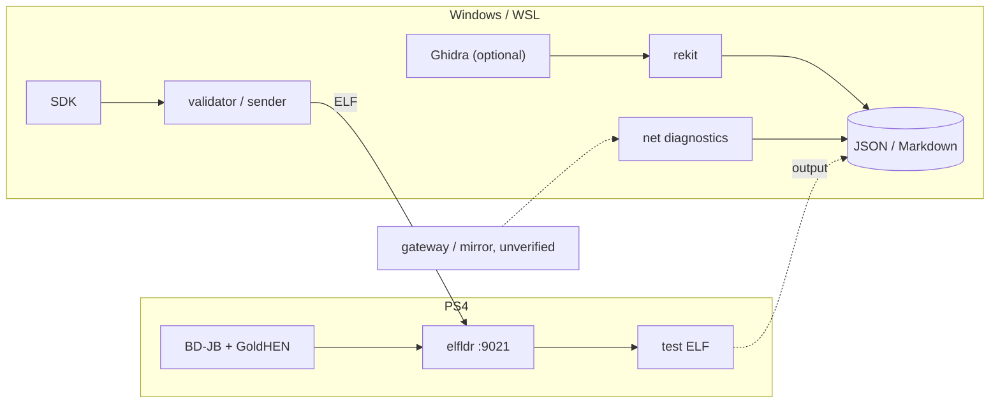

<div align="center">

# middleManPS4

**PS4 payload lab · offline Orbis/ELF reverse engineering · network observability**

<p>


</p>

ex `fwSpoofer`. Three things that are easier to study together: how a PS4 loads a payload, what's inside the binaries, what's visible on the wire.

[Quick start](#quick-start) · [The question](#the-actual-question) · [Toolkit](#toolkit) · [Evidence](#hardware-evidence) · [Architecture](#architecture) · [Roadmap](#roadmap)

</div>

```text
PS4 (BD-JB + GoldHEN)       Windows / WSL host
─────────────────────       ──────────────────
elfldr :9021        ──────► ELF validator + sender
firmware readout     ──────► structured evidence (JSON)
network traffic*     ──────► capture + baseline correlation

ELF / SFO / Orbis files ────► rekit ──► JSON / Markdown
                                  ▲
                              Ghidra (optional)

* only if the host is actually on the packet path
```

> **Not a PSN unlocker.** No firmware-version spoof, no PSN auth bypass, no TLS decryption, no online-on-unsupported-firmware. Every claim in this README is tagged tested, untested, or not implemented.

---

## the actual question

Does PSN check the reported system version client-side, server-side, or both — and is that check even reachable from the network path? Unknown. Three things have to hold before "spoofing" is more than a hypothesis, and none of them hold yet:

- [ ] PS4 → Internet traffic is visible to an observer (same Wi-Fi ≠ on-path)
- [ ] the version claim travels somewhere outside TLS — likely blocker
- [ ] the server side even cares, independent of the client

This repo exists to chip away at those three with evidence, not to skip past them.

---

## toolkit

| | |
|---|---|
| payload lab | build/validate test ELF, send over the tested `elfldr` path |
| firmware diagnostics | read-only `sceKernelGetSystemSwVersion`, nothing else |
| network lab | passive DNS/TLS/TCP metadata, baseline vs. sign-in attempt |
| rekit | offline ELF/Orbis/PSF/NID inspection, JSON/Markdown reports, optional Ghidra export |

## observer ELF (experimental, WIP)

The new `observer.elf` is a **read-only self-observation prototype**:
it reads firmware information, prints its own PID and emits 12 timed
heartbeats. Host-C mock tests pass; PS4 cross-build/runtime is **not yet
verified**. It does **not** hook PSN processes, decrypt TLS, collect
credentials, spoof firmware, or bypass authentication.

See [Observer v0.15](docs/OBSERVER-v15.md) for exact limitations and
the optional experimental build.

## gate trace v0.16 (offline, WIP)

A new metadata-only correlator reads allowlisted `observer.elf` stdout and
an existing `psn_netdiag` JSON. You can annotate when the update dialog
appeared and count DNS/TCP/TLS **metadata** on either side of the marker.
The clock marker is entered manually; this is **not** synchronized PSN
process tracing or proof of a local/server firmware gate.

```powershell
python -m host.ps4_sender.gate_trace --observer examples/observer_v016_sample.txt --network examples/netmeta_v016_sample.json --prompt-second 5 --window-seconds 3
```

The included inputs are **synthetic examples**; no PS4 access is needed.
See [Gate Trace v0.16](docs/GATE-TRACE-v16.md) for limitations.

## research workbench v0.17 (offline, WIP)

The unified workbench combines the experimental Observer stdout parser,
metadata-based Network Intelligence, offline ELF/PSF static binary diff, a
**localhost-only read-only dashboard**, rule-based analysis with separately
opt-in *local* Ollama, a non-transmitting event replay, and SHA-256 integrity
reports.

```powershell
New-Item -ItemType Directory -Force .\reports | Out-Null
python -m host.ps4_sender.workbench case --observer examples/observer_v016_sample.txt --network examples/netmeta_v016_sample.json --prompt-second 5 --output reports\synthetic.json
python -m host.ps4_sender.workbench verify --report reports\synthetic.json
python -m host.ps4_sender.workbench dashboard --report reports\synthetic.json
```

Demo inputs are **synthetic**. System-wide process enumeration and firmware
gate attribution are **not implemented or proven**.
See [Research Workbench v0.17](docs/RESEARCH-WORKBENCH-v17.md).

## live agent v0.18 (experimental, WIP)

LAN-paired **self-process telemetry** from an optional `live_agent.elf` to
a bounded Windows/Linux TCP receiver. The PC displays a read-only live
dashboard at `http://127.0.0.1:8769`. A 256-bit shared key authenticates
sessions using HMAC-SHA256 challenge/response; each event is MAC-checked.
Generated keys and the private C configuration are never tracked.

```powershell
python -m unittest tests.test_live_agent tests.test_pkg_stage -v
python -m host.ps4_sender.live_agent --help
```

The **actual PS4 ELF build/runtime is not yet verified**, and no installable
PKG has been built. The packaging script only stages independently created
OpenOrbis application inputs; an ELF for `elfldr` is *not* a PKG `eboot.bin`.
The ordinary userspace agent does not collect global syscalls or inspect
other processes, PSN requests or TLS content.

See [Live Agent v0.18](docs/LIVE-AGENT-v18.md) for pairing, local simulator,
optional SDK build, packaging prerequisites and limitations.

## hardware evidence

One console: PS4, 12.52, BD-JB, GoldHEN 2.4b18.7. Nothing below generalizes past this config.

| | result |
|---|---|
| build + offline host tests | host Python/C tests; see CI for latest results |
| GoldHEN → `elfldr` on TCP 9021 | tested |
| hello-world payload | tested — notification on console |
| firmware readout | tested — returns `12.520.001` |
| Ghidra headless export | untested — checked offline only |
| PS4 → Internet traffic visibility | not demonstrated |
| firmware-version spoofing | not implemented |
| PSN sign-in bypass | not implemented, no evidence it's feasible |

## quick start

```powershell
git clone https://github.com/oakvx/middleManPS4.git
cd middleManPS4
python -m unittest discover -s tests -v
```

```powershell
python -m host.ps4_sender.rekit analyze .\dist\firmware_info.elf
python -m host.ps4_sender.rekit analyze .\dist\firmware_info.elf --output .\reports\case.json
python -m host.ps4_sender.rekit markdown .\reports\case.json --output .\reports\case.md
```

`--output` never overwrites — use a new filename per run.

<details>
<summary><b>rekit — offline binary analysis</b></summary>

Reads files already on disk. Never touches the console.

```powershell
python -m host.ps4_sender.rekit binary  .\dist\firmware_info.elf
python -m host.ps4_sender.rekit orbis   .\dist\firmware_info.elf
python -m host.ps4_sender.rekit symbols .\dist\firmware_info.elf
python -m host.ps4_sender.rekit nids    .\dist\firmware_info.elf
python -m host.ps4_sender.rekit batch   .\dist --glob "*.elf"
python -m host.ps4_sender.rekit analyze-diff .\reports\before.json .\reports\after.json
```

A static string match is not proof a code path runs, and definitely not proof PSN accepts anything.

</details>

<details>
<summary><b>building payloads</b></summary>

```bash
export PS4_PAYLOAD_SDK="$HOME/ps4-payload-sdk-1252"
make
```

Targets the tested `elfldr` TCP 9021 path. A successful upload ≠ successful execution — check the console. Read [payload-development.md](docs/payload-development.md) first. Bad payloads crash consoles.

</details>

<details>
<summary><b>network lab</b></summary>

```powershell
python -m host.ps4_sender.psn_netdiag interfaces
python -m host.ps4_sender.psn_triage --baseline baseline.json --attempt psn_attempt.json
```

Same Wi-Fi ≠ on-path. A local ping reply proves nothing about PS4 → Internet visibility — see [PSN-VISIBILITY-v11.md](docs/PSN-VISIBILITY-v11.md). No credential capture, no TLS decryption, no endpoint impersonation.

</details>

## architecture



## roadmap

- [x] payload build + validate
- [x] GoldHEN + `elfldr` on real hardware
- [x] read-only firmware info
- [x] host test scaffolding
- [x] passive network metadata
- [x] offline ELF/Orbis/PSF/NID inspection
- [x] add read-only observer prototype (host mocks only)
- [ ] run the Ghidra export on a real install
- [ ] show PS4 → Internet visibility through a gateway/mirror
- [x] offline metadata-only prompt/Observer report (manual marker)
- [ ] correlate system-process events with network observations
- [ ] investigate whether the version check is even interceptable
- [x] unified offline workbench, deterministic replay, integrity and local dashboard
- [x] bounded authenticated LAN telemetry (host + C mock)
- [ ] live agent ELF cross-build and runtime on PS4 12.52
- [ ] installable PKG application built with OpenOrbis and validated on console
- [ ] read-only system process inventory validated on console
- [ ] live PS4 gateway capture and independently timed gate analysis
- [ ] packaging and end-user deployment

## docs

| | |
|---|---|
| [Live Agent v0.18](docs/LIVE-AGENT-v18.md) | authenticated metadata stream, PC dashboard, PS4 ELF and PKG staging |
| [Workbench v0.17](docs/RESEARCH-WORKBENCH-v17.md) | case, firmware diff, assistant, replay and dashboard |
| [Gate Trace v0.16](docs/GATE-TRACE-v16.md) | offline Observer and prompt metadata timeline |
| [RE Toolkit v0.14](docs/RE-TOOLKIT-v14.md) | report commands, Ghidra inventory |
| [Network visibility v0.11](docs/PSN-VISIBILITY-v11.md) | what "on-path" actually means |
| [PSN NetLab v0.10](docs/PSN-NETLAB-v10.md) | metadata diagnostics |
| [Payload development](docs/payload-development.md) | building and running test payloads |
| [Architecture](docs/architecture.md) | components and assumptions |
| [Changelog](CHANGELOG.md) | history |

## safety

Your own hardware and network, or explicit authorization — nothing else. Don't use accounts you care about. Never post credentials, tokens, or packet captures with personal data in issues.

## license

None published. Public source ≠ permission to reuse or redistribute.

---

<div align="center">

issues with reproducible evidence > issues asking "does it work yet"

</div>
