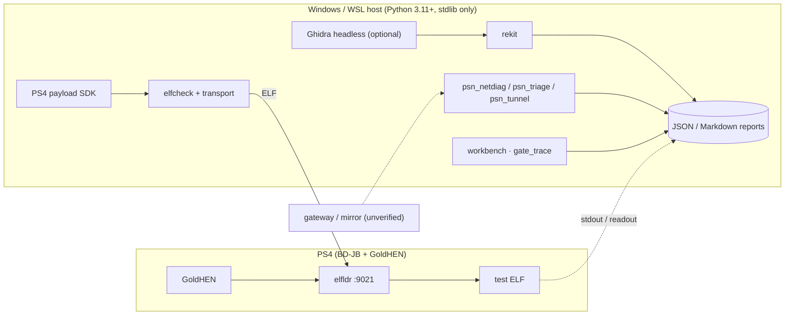

<div align="center">

# middleManPS4

**a payload lab that ships tags, not claims.**

Payloads in C. Offline Orbis/ELF forensics in Python. Network observability that
records metadata — and refuses to record anything else.
**Zero runtime dependencies. One console. Every claim carries a tag.**

<p>


</p>

*Formerly `fwSpoofer`. The rename is the honesty policy: nothing here spoofs anything.*

<!-- Demo slot — record the workbench dashboard, save as docs/assets/workbench.gif, uncomment:
<p align="center">
  
</p>
-->

</div>

> [!IMPORTANT]
> **Scope.** Research tooling for a console and a network you own. This is **not** a
> PSN unlocker: no firmware-version spoofing, no PSN authentication bypass, no TLS
> interception or decryption, no credential capture. Every capability below is labelled
> **tested**, **untested** or **not implemented** — and the tags are the product.

```powershell
git clone https://github.com/oakvx/middleManPS4.git
cd middleManPS4
python -m unittest discover -s tests -v
```

## Contents

- [The question](#the-question)
- [System overview](#system-overview)
- [What's in the box](#whats-in-the-box)
- [Observer ELF (experimental)](#observer-elf-experimental)
- [Gate trace v0.16 (offline)](#gate-trace-v016-offline)
- [Research workbench v0.17 (offline)](#research-workbench-v017-offline)
- [`psn_tunnel`](#psn_tunnel-the-forwarder-that-logs-almost-nothing)
- [House rules](#house-rules)
- [Quick start](#quick-start)
- [CLI reference](#cli-reference)
- [The hardware ledger](#the-hardware-ledger)
- [Roadmap](#roadmap)
- [Documentation](#documentation)
- [Safety & license](#safety--license)

## The question

Does PSN check the reported system version client-side, server-side, or both — and is
that check even reachable from the network path?

**Unknown.** Three preconditions must hold before "spoofing" is more than a hypothesis,
and none is established:

- [ ] PS4 → Internet traffic is visible to an observer (same Wi-Fi does not imply on-path).
- [ ] The version claim travels somewhere outside TLS (likely blocker).
- [ ] The server side cares, independently of the client.

This repository gathers evidence on those three points. **It does not try to bypass them.**
Every tool below exists to move one of those boxes — or to report honestly that it can't.

## System overview



## What's in the box

Every component, its language, its job — and whether it ever touches the console.

| Path | Language | Role | Touches console |
| --- | --- | --- | --- |
| `payloads/` (`hello_world`, `firmware_info`, `observer`, `common`) | C, PS4 payload SDK | Test payloads, built with `make` and `PS4_PAYLOAD_SDK` | Yes, via `elfldr` |
| `host/ps4_sender/` `elfcheck`, `transport`, `cli` | Python | Validate an ELF and send it to `elfldr` on TCP 9021 | Yes |
| `host/ps4_sender/diagnostics.py` | Python | Read-only firmware readout (`sceKernelGetSystemSwVersion`) | Yes |
| `host/ps4_sender/psn_netdiag`, `psn_triage`, `psn_diag` | Python | Passive DNS/TCP/TLS **metadata**; baseline vs. sign-in attempt | No |
| `host/ps4_sender/psn_tunnel.py` | Python | Opaque HTTPS `CONNECT` forwarder that logs metadata only | Network only |
| `host/ps4_sender/rekit/` | Python | Offline ELF / Orbis / PSF / NID / symbol inspection, reports, Ghidra bridge | No |
| `host/ps4_sender/gate_trace.py` | Python | Offline correlator of `observer.elf` stdout and network metadata around a manual marker | No |
| `host/ps4_sender/workbench.py`, `workbench_ui.py` | Python | Unified case builder, integrity verification, replay, localhost dashboard | No |

**Zero runtime dependencies** (`dependencies = []`). The host tooling is Python 3.11+
standard library, full stop. Ghidra and the PS4 payload SDK are separate optional
external tools — never imported, never required.

### Observer ELF (experimental)

A read-only self-observation prototype: reads firmware information, prints its own PID,
emits 12 timed heartbeats — and stops there.

- Host-C mock tests pass. **PS4 cross-build and runtime are not verified.**
- It does not hook PSN processes, decrypt TLS, collect credentials, spoof firmware or bypass authentication.

See [Observer v0.15](docs/OBSERVER-v15.md).

### Gate trace v0.16 (offline)

Reads allowlisted `observer.elf` stdout plus an existing `psn_netdiag` JSON, then counts
DNS/TCP/TLS metadata on either side of a marker **you type in by hand** ("the update
dialog appeared"). That is the entire method: it is not synchronized process tracing,
and it is not proof of a local or server firmware gate. Bundled inputs are synthetic.
See [Gate Trace v0.16](docs/GATE-TRACE-v16.md).

```powershell
python -m host.ps4_sender.gate_trace --observer examples/observer_v016_sample.txt --network examples/netmeta_v016_sample.json --prompt-second 5 --window-seconds 3
```

### Research workbench v0.17 (offline)

One offline case builder that fuses: the Observer stdout parser, metadata-based network
intelligence, offline ELF/PSF static diff, a **localhost-only read-only dashboard**,
rule-based analysis (local Ollama only if separately opted in), a non-transmitting event
replay, and SHA-256 integrity reports.

Demo inputs are synthetic. System-wide process enumeration and firmware-gate attribution
are **not implemented or proven** — and the dashboard won't imply otherwise.
See [Research Workbench v0.17](docs/RESEARCH-WORKBENCH-v17.md).

```powershell
New-Item -ItemType Directory -Force .\reports | Out-Null
python -m host.ps4_sender.workbench case --observer examples/observer_v016_sample.txt --network examples/netmeta_v016_sample.json --prompt-second 5 --output reports\synthetic.json
python -m host.ps4_sender.workbench verify --report reports\synthetic.json
python -m host.ps4_sender.workbench dashboard --report reports\synthetic.json
```

### `psn_tunnel`: the forwarder that logs almost nothing

A strict CONNECT forwarder for a user's own PS4. It relays opaque encrypted bytes and is
explicitly **not** a TLS MITM. The design brief: relay exactly one client's traffic,
refuse nearly everything else, record nearly nothing.

| Property | Behavior |
| --- | --- |
| Client | Exactly one private IPv4 (`--client-ip`); other sources are dropped |
| Listening | Loopback by default; LAN requires `--allow-lan`. **Dry run** unless `--serve` is given |
| Window | 5–300 s listening time; each tunnel capped at 120 s; at most 8 concurrent |
| Requests | `CONNECT host:443` only, strict header syntax; no plaintext forwarding |
| Destinations | Valid public hostnames or global IPs; `localhost`, `.local`, `.internal` and non-global addresses are refused |
| DNS | Resolved once and connected to a vetted global address (no second lookup, no rebinding) |
| Logging | Host, port, result and byte counts only. No headers, bodies, tokens, certificates or TLS records |
| Report | Optional JSONL, **new file only** |

> [!NOTE]
> No `--serve` flag, no listener. The dry run validates arguments and opens nothing.

```powershell
# dry run: validates arguments, opens nothing
python -m host.ps4_sender.psn_tunnel --client-ip 192.168.1.50 --report reports\tunnel.jsonl
# serve on the LAN for the PS4 only
python -m host.ps4_sender.psn_tunnel --client-ip 192.168.1.50 --bind 192.168.1.10 --allow-lan --serve --seconds 90
```

> [!CAUTION]
> Point the PS4 HTTPS proxy at the host and port while capturing — and **remove it
> afterwards**, or the console keeps trying to browse through your host.

## House rules

The constraints aren't compliance overhead. They're the method.

- **Read-only on the console.** Firmware readout and observer only read; nothing patches, hooks or injects into system processes.
- **No overwrite.** Report and Markdown writers create new files exclusively; `--output` never replaces an existing file.
- **Metadata only.** Network tooling records DNS/TCP/TLS metadata. No credential capture, TLS decryption or endpoint impersonation.
- **Claims are tagged.** A static string match is not proof that a code path runs — and not proof that PSN accepts anything.
- **Single-config evidence.** Results apply to one console and one firmware only. That is the honest unit of measurement (see [the hardware ledger](#the-hardware-ledger)).

## Quick start

Inspect an ELF — fully offline, never touches the console:

```powershell
python -m host.ps4_sender.rekit analyze .\dist\firmware_info.elf
python -m host.ps4_sender.rekit analyze .\dist\firmware_info.elf --output .\reports\case.json
python -m host.ps4_sender.rekit markdown .\reports\case.json --output .\reports\case.md
```

Build payloads (targets the tested `elfldr` TCP 9021 path):

```bash
export PS4_PAYLOAD_SDK="$HOME/ps4-payload-sdk-1252"
make
```

> [!WARNING]
> A successful upload is **not** a successful execution — check the console.
> Read [payload-development.md](docs/payload-development.md) first. Bad payloads crash consoles.

Network lab:

```powershell
python -m 
