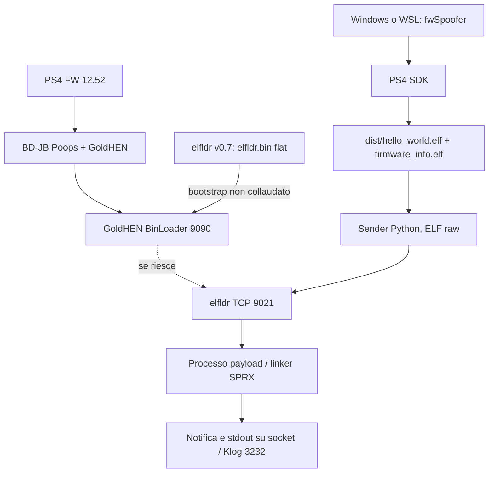

# Architettura effettiva: BD-JB / GoldHEN / elfldr

Le frecce tratteggiate indicano un **passaggio non ancora verificato in hardware**.
La porta 9090 e' il BinLoader sperimentale di GoldHEN; il sender non invia
ELF direttamente su tale porta. Il percorso Lua/Artemis 9026 -> 9020 e'
un'alternativa documentata upstream, ma NON e' un prerequisito del jailbreak
BD-JB dell'utente e non va avviata alla cieca.

`fw_info_read` interroga un'API di sistema in sola lettura. Il progetto non
modifica il firmware, la memoria kernel per lo spoofing, ne' i servizi PSN.
